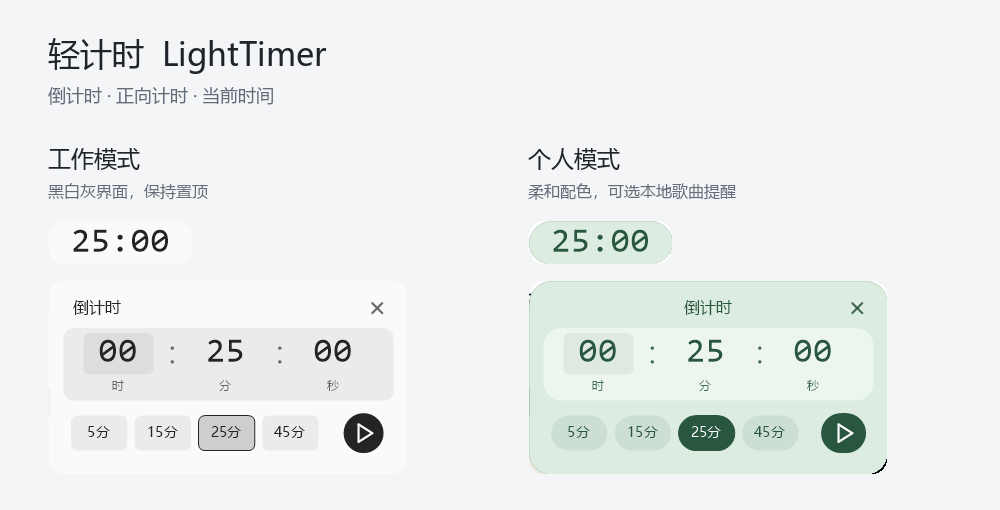
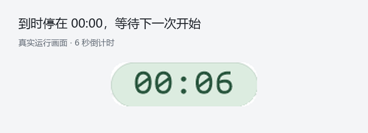

# 轻计时 · LightTimer

一个放在桌面角落的 Windows 计时工具。支持倒计时、正向计时和当前时间，解压即可使用，无需安装。

**Windows 10 / 11 · 64 位 · 离线运行 · 单文件程序**

[下载最新版](https://github.com/suiyunzou/light-timer/releases/latest) · [使用方法](#使用方法) · [常见问题](#常见问题) · [开发说明](docs/development.md) · [反馈问题](https://github.com/suiyunzou/light-timer/issues)

## 下载与开始

1. 打开 [下载页面](https://github.com/suiyunzou/light-timer/releases/latest)，下载 `LightTimer-Windows-x64.zip`。
2. 解压到你想保存的位置，双击 `LightTimer.exe`。
3. 首次打开显示 **25:00**，尚未开始计时。把鼠标停在浮窗上，点击中间的开始按钮。

需要其他时长时，点击浮窗上的齿轮，输入时、分、秒，或选择 **5 / 15 / 25 / 45 分钟**，再点击播放按钮开始。

> 下载页面中的 **Source code** 是源代码。普通用户请选择 `LightTimer-Windows-x64.zip`。

## 能做什么

| 功能 | 用法 |
| --- | --- |
| 倒计时 | 设定时长，到时显示 `00:00`，可选择提示音或短暂的全屏提醒。 |
| 正向计时 | 从零开始记录时间，支持暂停、继续和暂停后归零。 |
| 当前时间 | 显示系统本地时间，使用 24 小时制。 |
| 工作模式 | 黑白灰界面，浮窗保持置顶，到时不播放自选歌曲。 |
| 个人模式 | 可选雾绿、暖杏、雾紫配色，可调整置顶、磨砂和本地歌曲提醒。 |
| 托盘运行 | 隐藏浮窗后继续计时，通过托盘图标恢复。 |

### 倒计时演示

下面是实际程序运行的 6 秒倒计时。GIF 循环播放；程序到时后停在 `00:00`，不会自动开始下一轮。画面已放大，便于查看。

## 使用方法

### 浮窗操作

| 想做的事 | 操作 |
| --- | --- |
| 显示按钮 | 将鼠标停在浮窗上约半秒；移开后恢复时间显示。也可按 Tab。 |
| 暂停或继续 | 点击浮窗中间的按钮。 |
| 修改倒计时 | 在倒计时视图中点击齿轮。 |
| 切换计时或时钟 | 点击左侧的时间类型图标，选择倒计时、正向计时或当前时间。 |
| 移动浮窗 | 按住浮窗拖动，包括按钮区域。 |
| 隐藏或恢复 | 单击托盘图标，或再次双击程序／快捷方式。隐藏不会暂停计时。 |
| 到时再来一轮 | 停在 `00:00` 后，点击中间的重新开始按钮。 |
| 退出程序 | 右键浮窗或托盘图标，选择“退出”。 |

**切换视图不会改变计时进度。** 开始或继续另一种计时时，会自动暂停原来的计时；同一时刻只运行一个计时任务。正向计时需暂停后才能归零。

### 设置时长

- 点击时、分、秒，直接输入数值。也可用方向键微调，按 Tab 切换输入位置。
- 鼠标停在某段数字上时，滚轮向下增大、向上减小。
- 选择预设只修改时长，点击播放按钮或按 Enter 后才开始。
- 最长支持 `99:59:59`。小于一小时时显示分、秒，达到一小时时显示时、分、秒。

### 提醒与音乐

右键浮窗或托盘图标，打开 **提醒** 菜单：

- **浮窗提醒**：最后 5 秒数字轻微呼吸，到时显示 `00:00`。
- **全屏倒数**：到时显示全屏圆环倒数，默认 3 秒，可设为 1～5 秒。结束后自动关闭，也可按 Esc 提前关闭。
- **提示音**：可独立开启或关闭。
- **选择歌曲**：在个人模式下选择本地 MP3 或 WAV，可试听、停止、关闭自动播放或清除歌曲。

歌曲会播放到自然结束，不受全屏提醒时长限制。播放时可点击浮窗上的停止图标，或从托盘菜单停止。工作模式不会播放自选歌曲；切回个人模式也不会立即播放。

成功播放歌曲时不叠加提示音。歌曲丢失或播放失败时，程序按提示音设置提醒，计时仍正常结束。

### 外观

通过右键菜单的 **使用模式** 选择工作或个人模式。个人模式下，**窗口外观** 提供配色、置顶和磨砂选项。切换模式会保留个人设置。

程序跟随系统深色主题与高对比度设置。系统关闭动画或透明效果时，界面会减少动效或使用实色背景。

## 数据与隐私

- 程序离线运行，不联网，不上传使用数据。
- 不添加开机启动，不安装服务，不需要管理员权限。
- 偏好设置保存在 `%LOCALAPPDATA%\LightTimer\settings.ini`，包括时长、窗口位置、外观和所选歌曲的本地路径。
- 歌曲保留在你选择的位置，程序不会复制或上传歌曲。
- 重启会保留时长和偏好，但不会恢复上一轮的计时进度。

向他人反馈问题时，请先检查截图和配置文件，移除个人路径等信息。

## 常见问题

**为什么双击程序后浮窗消失了？**
程序已在运行时，再次启动会切换显示与隐藏。单击托盘图标即可恢复；图标也可能位于任务栏的隐藏图标区域。

**电脑睡眠时还会计时吗？**
睡眠时间计入计时，但程序不会唤醒电脑。电脑恢复后，程序会检查倒计时是否到期。

**为什么选好的歌曲没有播放？**
请确认处于个人模式，已开启歌曲自动播放，并且原文件仍在原位置。可先从提醒菜单试听；文件移动或删除后需要重新选择。

**如何卸载或重置？**
先从托盘菜单退出，再删除 `LightTimer.exe` 即可移除程序。需要清除偏好时，再删除 `%LOCALAPPDATA%\LightTimer` 文件夹；这不会删除原来的歌曲文件。

**需要安装运行环境吗？**
不需要 Python、.NET、浏览器或 WebView。发布程序只依赖 Windows 系统 DLL。

## 兼容性与开发

面向 **Windows 10 / 11 x64**。当前实际验证环境为 Windows 10 22H2、125% 缩放、单显示器；Windows 11 外观与多显示器行为尚未完成真机验证。

源码使用 C++17、Win32 和 GDI/GDI+。构建方式、测试范围和目录说明见 [开发说明](docs/development.md)。
